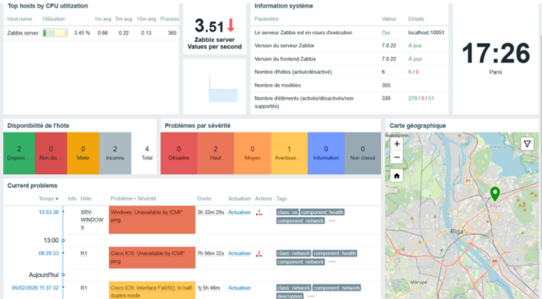

# Supervision d'infrastructure avec Zabbix

Lab réalisé en B2 à Sup de Vinci (module Initiation à la supervision, février 2026).
Objectif : mettre en place une supervision de bout en bout d'un petit parc hétérogène avec Zabbix 7.0.

## Périmètre supervisé
- 1 serveur Linux (Ubuntu) via agent Zabbix
- 1 serveur Windows via SNMP
- 1 routeur Cisco via SNMP
- Environnement virtualisé : [hyperviseur à confirmer]

## Ce qui a été mis en place
- Organisation en groupes d'hôtes et templates (Linux by Zabbix agent, Windows by SNMP, Cisco IOS by SNMP)
- Seuils d'alerte paramétrés avec des macros d'hôte (CPU 80 %, RAM 80 %, disque 90 %)
- Déclencheur CPU : alerte si > 80 % pendant 5 minutes
- Éléments personnalisés hors templates : mémoire libre via agent SSH, statut du service Spouleur via SNMP
- Tableau de bord (CPU, trafic réseau, occupation disque) et gestion des alertes (incident sur le routeur détecté par ICMP)

## Captures d'écran
### Tableau de bord

### Hôtes supervisés

### Seuils d'alerte (macros)

### Déclencheur CPU

### Graphiques de charge

### Alerte sur le routeur R1

## Compétences mobilisées
Zabbix, SNMP (v2c/v3), supervision agent / sans agent, gestion des seuils et alertes, dépannage d'un hôte muet.
